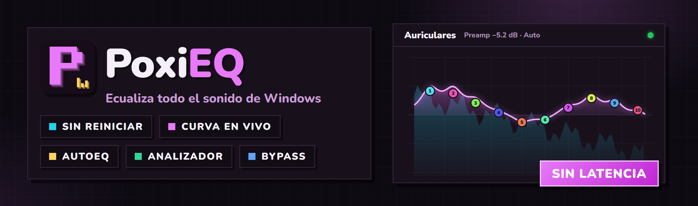
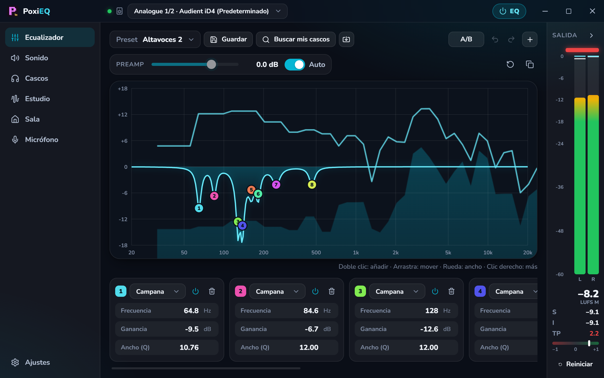
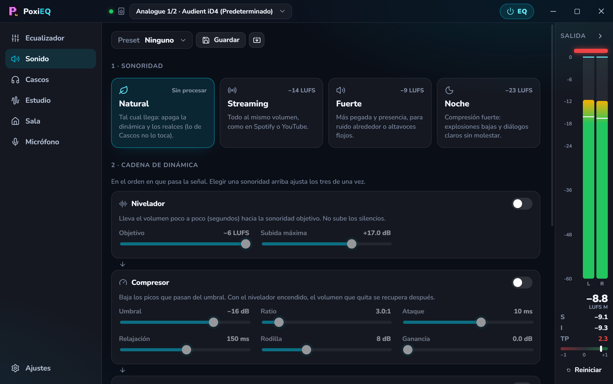
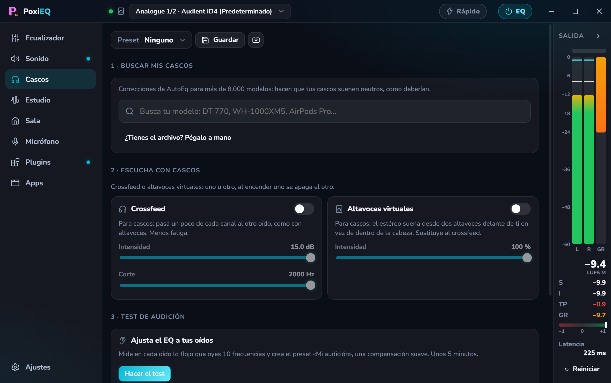
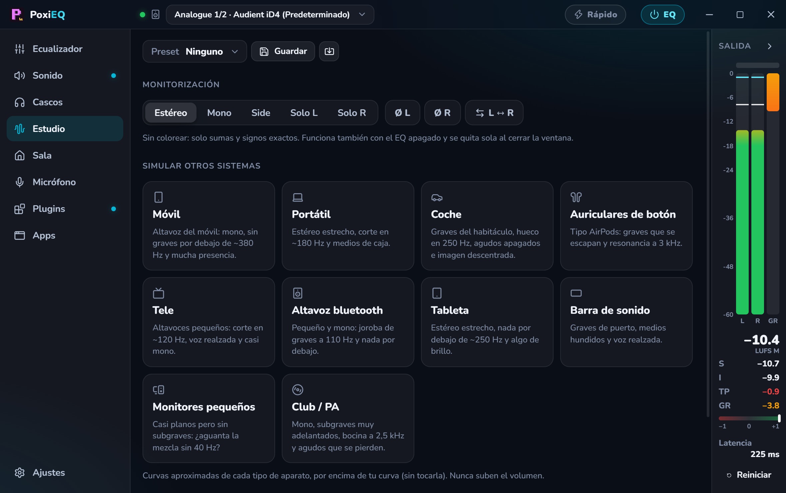
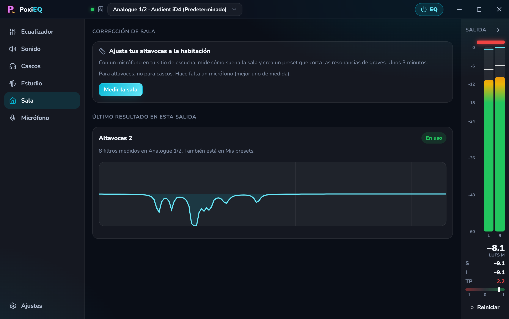
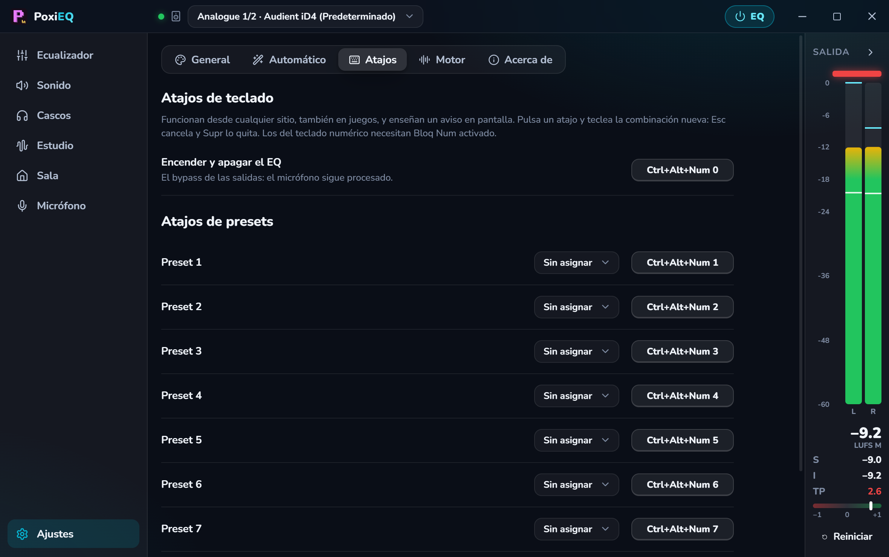

<div align="center">



<br />


**🇪🇸 Español** · [🇬🇧 English](#-english)

### Ecualiza **todo** el sonido de Windows.

Juegos, música, Discord, el navegador: todo pasa por tu curva, **sin retraso** y **sin reiniciar el PC**.
Con medidores de estudio, dinámica, altavoces virtuales para cascos, corrección de sala y tu micrófono procesado.

</div>

---

## 🎯 Qué es

**PoxiEQ** es un ecualizador para la salida de audio de Windows hecho por y para gente que escucha con atención:
lo que ajustes se aplica a **todo lo que suena** en el PC. Arrastras un punto de la curva y el sonido cambia al
instante, mientras ves el espectro y el volumen real (LUFS, true peak) de lo que está sonando.

No es un «potenciador de sonido» de los que lo colorean todo: con todo apagado **no toca ni un bit**, y cada cosa
que enciendes hace exactamente lo que dice. Por dentro usa un motor de audio de código abierto que se mete dentro
de Windows; PoxiEQ lo instala, lo activa y lo esconde por ti con **un clic**.

## 📸 Así se ve

<table>
  <tr>
    <td width="50%"></td>
    <td width="50%"></td>
  </tr>
  <tr>
    <td align="center"><sub>🎚️ La curva en vivo, con el espectro de lo que suena y los medidores siempre a la vista</sub></td>
    <td align="center"><sub>🔊 Sonoridad en un clic y la cadena nivelador → compresor → limitador</sub></td>
  </tr>
  <tr>
    <td width="50%"></td>
    <td width="50%"></td>
  </tr>
  <tr>
    <td align="center"><sub>🎧 Busca tus cascos entre más de 8.000 modelos, crossfeed y altavoces virtuales</sub></td>
    <td align="center"><sub>🎛️ Mono, side, solo L / R, polaridad y cómo suena tu mezcla en un móvil o un coche</sub></td>
  </tr>
  <tr>
    <td width="50%"></td>
    <td width="50%"></td>
  </tr>
  <tr>
    <td align="center"><sub>📐 Corrección de sala: mide tus altavoces y corta las resonancias de graves</sub></td>
    <td align="center"><sub>⌨️ Bypass y nueve presets con el atajo que tú grabes</sub></td>
  </tr>
</table>

## 📥 Descarga

### **[⬇️ Descargar PoxiEQ 0.2.0 para Windows](https://github.com/PoxiiTV/PoxiEQ/releases/download/v0.2.0/PoxiEQ-Setup-0.2.0.exe)**

Instalador de 3 MB: crea los accesos, arranca con Windows si quieres y **se actualiza solo**.

Todas las versiones y sus novedades, en [**Releases**](https://github.com/PoxiiTV/PoxiEQ/releases).
Requiere **Windows 10 u 11 de 64 bits**.

> 🛡️ La primera vez, PoxiEQ te ofrece activar su motor en tu salida de audio: Windows pide **permiso de
> administrador una vez** (el motor vive dentro del audio de Windows) y el sonido se corta un par de segundos.
> **No hace falta reiniciar.**

> ℹ️ Como el `.exe` aún no está firmado con un certificado, Windows puede enseñar el aviso azul de SmartScreen
> (**Más información → Ejecutar de todas formas**) y algún antivirus puede desconfiar de él por ser nuevo. El código
> está entero aquí.

---

## 🌟 Lo que lo hace distinto

| | |
|---|---|
| ⚡ **Sin reiniciar, en un clic** | Descarga el motor oficial (comprobando su huella SHA-256), lo instala en silencio y lo engancha a tus cascos o altavoces. Lo de siempre con estos ecualizadores era reiniciar el PC; aquí solo se corta el sonido un par de segundos |
| 🎯 **Fiel por defecto** | Con todo apagado es **bit-transparente**. Preamp automático para que la curva nunca sature, limitador de **true peak** y nada que se encienda solo: el loudness automático viene **apagado** |
| 📊 **Medidores de estudio, siempre a la vista** | Pico y RMS por canal, **LUFS** momentáneo, corto e integrado, **true peak**, correlación de fase y la reducción de ganancia del compresor y el limitador. Miden **después** del EQ: lo que de verdad oyes |
| 🎧 **Tus cascos, corregidos** | Escribe tu modelo y aplica su corrección de [AutoEq](https://github.com/jaakkopasanen/AutoEq) (más de 8.000 modelos) sin salir de la app, con graves y agudos a tu gusto |
| 🔁 **Cada dispositivo con lo suyo** | Cada salida guarda su curva, su Sonido y sus Cascos; cada micrófono, lo suyo. Conectas unos cascos o un altavoz Bluetooth, Windows cambia a él y **PoxiEQ cambia solo a su EQ** |
| 🔌 **Tus plugins VST** | VST2 y VST3 en la cadena de cada salida o micrófono, con su ventana de verdad y sus medidores en vivo. Cada uno en su propio proceso: si uno se cuelga, el audio de Windows sigue |
| 🎙️ **Tu micrófono, procesado** | EQ, **supresión de ruido**, **puerta** y **compresor** antes de que llegue a Discord, OBS o cualquier app |
| 🛠️ **Se repara solo** | Si Windows o un driver le quitan el motor a una salida, PoxiEQ lo ve y lo repara con un clic. Y si algo no suena, **¿Por qué no suena?** te dice qué pasa |
| 🙈 **Limpio** | El motor no deja accesos en el menú Inicio ni avisos suyos. Se quita desde **Ajustes → Motor** o al desinstalar PoxiEQ, y devuelve cada dispositivo a como estaba |

## 🎚️ Ecualizador

| | |
|---|---|
| 🖱️ **Curva en vivo** | Arrastra los puntos, la **rueda** cambia el ancho (Q), **doble clic** añade una banda y el **clic derecho** cambia el tipo: campana, graves, agudos, paso bajo y paso alto |
| 📈 **Analizador detrás de la curva** | Espectro con retención de picos o **espectrograma**, para ver lo que suena mientras ecualizas |
| 🅰️🅱️ **A/B igualado** | Compara con y sin tu curva al **mismo volumen**: sin que «más alto» parezca «mejor» |
| 🗂️ **Presets** | Plano, Más graves, Voz clara, Pasos (gaming), Cine, Música, Noche… y los tuyos |
| ↩️ **Deshacer** | `Ctrl+Z` / `Ctrl+Y` en la curva y la dinámica: un arrastre entero es un solo paso |

## 🔊 Sonido

| | |
|---|---|
| 🎛️ **Sonoridad en un clic** | **Natural** (sin procesar), **Streaming** (−14 LUFS, como Spotify o YouTube), **Fuerte** (−9) y **Noche** (−23: explosiones bajas y diálogos claros) |
| ⛓️ **Cadena de dinámica** | Nivelador por LUFS → compresor → limitador de true peak (nunca pasa de −1 dBTP), con todos los controles a la vista |
| 🔈 **Graves** | Una rueda: hasta **+10 dB** de graves limpios y con pegada, sin embarrar los medios y con protección para que nunca sature |
| ✨ **Realces** | Armónicos de graves (para altavoces pequeños) y realce de diálogos |

## 🎧 Cascos

| | |
|---|---|
| 🔎 **Buscar mis cascos** | Corrección de AutoEq para tu modelo; también vale pegar su archivo. Con otras **curvas objetivo** y **«Suena como»** otro modelo |
| 🌀 **Convolución** | Carga una respuesta al impulso en WAV (BRIR de HeSuVi/Impulcifer, FIR de REW) y ve su respuesta dibujada |
| 🔀 **Crossfeed** | Un poco de cada canal al otro oído, como con altavoces: menos fatiga en sesiones largas |
| 🔊 **Altavoces virtuales** | El estéreo suena desde dos altavoces delante de ti (±30°) en vez de dentro de la cabeza. Respuestas de cabeza reales (KEMAR del MIT), con la intensidad regulable sin cambiar el timbre del centro |
| 👂 **Test de audición** | Mide tu umbral en 10 frecuencias en cada oído y crea «Mi audición», una compensación suave por oído. No es una prueba médica |

## 🎛️ Estudio

| | |
|---|---|
| 🎚️ **Monitorización** | Mono, side, solo L / R, invertir la polaridad de cada canal e intercambiarlos. Exactos y sin colorear, también con el EQ apagado |
| 📱 **Simular otros sistemas** | Móvil, tablet, portátil, coche, auriculares de botón, tele, barra de sonido, altavoz Bluetooth, monitores de estudio y club, para comprobar cómo traduce una mezcla. Nunca suben el volumen. Con **inclinación** de tono ±6 dB |
| ⏱️ **Momentáneo** | Mientras algo de Estudio está puesto se ve un aviso, y al cerrar la ventana todo vuelve a estéreo normal |

## 📐 Sala y 🎙️ Micrófono

| | |
|---|---|
| 📐 **Corrección de sala** | Con un micrófono en tu sitio: barridos en varias posiciones, media y hasta 10 filtros calculados solos, sobre todo de **corte** (las subidas tienen tope y nunca por debajo de donde llega tu altavoz). Unos 3 minutos. Admite la calibración de tu micrófono de medida |
| 🎙️ **Micrófono** | Su EQ, **supresión de ruido** (RNNoise), puerta de ruido con histéresis y compresor, con medidor de entrada y la raya del umbral de la puerta. Tiene **su propio bypass**: el atajo del EQ no te quita la puerta en mitad de un directo |

## ☕ Para el día a día

| | |
|---|---|
| 🎯 **Apps** | Cada app con su preset (Spotify → Música, tu juego → Pasos) y **su salida de audio** (Spotify a los altavoces, el juego a los cascos). **Atenuación** automática cuando habla Discord y un mezclador juego/chat con atajos |
| ⚡ **Activar solos** | Los dispositivos nuevos que conectes se activan sin volver a pedir permiso (opcional) |
| 📄 **Tus archivos** | Importa y exporta curvas de REW, Peace, EasyEffects, AutoEq y GraphicEQ. **Balance** izquierda/derecha por salida |
| ⌨️ **Atajos a tu gusto** | Bypass y nueve presets, cada uno con la combinación que grabes (por defecto `Ctrl+Alt+Num 0…9`). Rechaza las que chocan con **AltGr** (que te dejarían sin `€ \| @ # ~`) y avisa si otro programa ya tiene esa combinación. Con un aviso en pantalla que **no roba el foco** al juego |
| 🗂️ **Presets en todas las secciones** | Sonido, Cascos, Estudio y Micrófono tienen sus propios presets, y cada salida recuerda el último de cada una |
| 🔗 **Compartir** | Cualquier preset como **código** para pegar en un chat o como archivo **`.poxieq`**: arrástralo a la ventana y va a su sección |
| 🧺 **Bandeja** | Bypass, cambio de preset y una **mini-barra** con el medidor siempre encima, sin abrir la ventana. Al cerrar, PoxiEQ se queda en la bandeja; aunque lo cierres del todo, el EQ sigue sonando |
| 🎨 **A tu gusto** | Tema oscuro y claro, 7 colores, español e inglés |

## 🔄 Siempre al día

- **Se actualiza solo:** busca versiones nuevas al abrir y cada 6 horas, se descarga, se instala en unos segundos **y se vuelve a abrir**.
- **Novedades dentro de la app** después de cada actualización.

## 🛡️ Privacidad y seguridad

- 🏠 **Todo pasa en tu PC.** No hay cuentas ni servidor propio, y no envía nada de lo que escuchas.
- 🌐 Solo se conecta para tres cosas: comprobar si hay versión nueva (GitHub), bajar la lista y las correcciones de AutoEq (GitHub, con caché semanal) y descargar el motor la primera vez (su web oficial).
- ✅ El motor se comprueba **por su huella SHA-256** antes de instalarlo, y las actualizaciones de PoxiEQ van **firmadas**.
- 🔐 Lo que necesita administrador (activar el motor en un dispositivo) va en un paso aparte con **un solo aviso** de Windows, y nunca sin pulsar el botón.

## ❓ Preguntas

- **¿Si cierro PoxiEQ deja de ecualizar?** No. El motor sigue aplicando lo último que pusiste; PoxiEQ solo hace falta para cambiarlo. Lo único que necesita PoxiEQ abierto (aunque sea en la bandeja) son tus plugins VST.
- **¿Por qué mi antivirus lo marca?** Es un falso positivo de un programa nuevo y sin certificado de firma: los antivirus desconfían de lo que casi nadie ha descargado todavía, y más si toca el audio de Windows y pide administrador. El código está aquí entero; si te pasa, avísame en [Issues](https://github.com/PoxiiTV/PoxiEQ/issues).
- **¿Cómo lo quito de un dispositivo?** **Ajustes → Motor**: apaga esa salida y aplica. Vuelven sus efectos originales.
- **¿Y para quitarlo del todo?** Desinstala PoxiEQ: se lleva el motor con él. O quita solo el motor desde **Ajustes → Motor**.
- **¿Cómo proceso mi micrófono?** En **Micrófono**, elige tu micro y actívalo. Lo que ajustes ahí lo reciben todas las apps que lo usen.
- **¿Y si ya usaba Equalizer APO?** PoxiEQ guarda tu `config.txt` como `config.antes-de-poxieq.txt` antes de tocarlo.

---

## 🔧 Compilar

Necesitas [Node.js](https://nodejs.org) 20 o superior y [Rust](https://rustup.rs) (stable, MSVC).

```bat
start.bat       :: modo desarrollo
deploy.bat      :: instalador firmado + latest.json en deploy-hosting\
```

Antes de cada commit:

```bat
cd src-tauri && cargo test && cargo clippy --all-targets
cd dsp && cargo test && cargo clippy --all-targets
npx tsc --noEmit -p . && npm test && npm run check
```

Variables del `.env` (no se sube nunca al repo):

| Variable | Qué es |
|---|---|
| `TAURI_SIGNING_PRIVATE_KEY` | Clave privada que firma las actualizaciones (la pública va en `tauri.conf.json`) |
| `TAURI_SIGNING_PRIVATE_KEY_PASSWORD` | Su contraseña |

### 🗃️ Estructura

```
src-tauri/src/   la app (Rust): motor y registro de Windows, analizador y medidores, AutoEq, atajos,
                 preset por app, aviso en pantalla y corrección de sala
dsp/             PoxiDSP: el plugin propio que carga el motor (dinámica, graves, crossfeed,
                 altavoces virtuales, puerta de ruido)
src/             la interfaz (React + TypeScript), textos en ES/EN
scripts/         icono, latest.json, comprobación de textos y respuestas de cabeza (KEMAR)
```

## 🙏 Gracias a

- **[Equalizer APO](https://sourceforge.net/projects/equalizerapo/)** de Jonas Thedering: el motor que hace sonar todo. PoxiEQ no lo incluye ni lo modifica: descarga su instalador oficial.
- **[AutoEq](https://github.com/jaakkopasanen/AutoEq)** de Jaakko Pasanen: las correcciones de cascos.
- **[KEMAR del MIT Media Lab](https://sound.media.mit.edu/resources/KEMAR.html)** (Bill Gardner y Keith Martin): las respuestas de cabeza de los altavoces virtuales.
- **[bs2b](https://bs2b.sourceforge.net/)** de Boris Mikhaylov: los filtros del crossfeed.
- **[Tauri](https://tauri.app)**, **[ebur128](https://github.com/sdroege/ebur128)** y **[lucide](https://lucide.dev)**.

Todos los créditos y licencias en [`THIRD-PARTY.md`](THIRD-PARTY.md).

## 📜 Licencia

[PolyForm Noncommercial 1.0.0](LICENSE).

Puedes **usarlo, estudiarlo, modificarlo y compartirlo libremente** mientras el uso **no sea comercial**: uso
personal, aprendizaje, proyectos de aficionado, centros educativos y organizaciones sin ánimo de lucro.

¿Tu propia versión? Adelante, pero **cambia el nombre, el logo y la clave de firma** por los tuyos.

Para cualquier otra cosa: **alexissjuarezz10@gmail.com**

<div align="center">

---

hecho con 💜 por [poxi](https://github.com/PoxiiTV)

</div>

---

<div align="center">

# 🇬🇧 English

### Equalize **all** of Windows' sound.

Games, music, Discord, the browser: everything goes through your curve, **with zero latency** and **without
restarting your PC**. With studio meters, dynamics, virtual speakers for headphones, room correction and your
microphone processed.

</div>

## 🎯 What it is

**PoxiEQ** is an equalizer for the Windows audio output, made by and for people who listen carefully: whatever you
set applies to **everything that plays** on the PC. Drag a point on the curve and the sound changes instantly, while
you see the spectrum and the real loudness (LUFS, true peak) of what's playing.

It isn't a "sound enhancer" that colors everything: with everything off it **doesn't touch a single bit**, and each
thing you turn on does exactly what it says. Under the hood it uses an open source audio engine that plugs into
Windows; PoxiEQ installs, enables and hides it for you in **one click**.

## 📥 Download

### **[⬇️ Download PoxiEQ 0.2.0 for Windows](https://github.com/PoxiiTV/PoxiEQ/releases/download/v0.2.0/PoxiEQ-Setup-0.2.0.exe)**

A 3 MB installer: creates shortcuts, optionally starts with Windows and **updates itself**.

Every version and its changes, in [**Releases**](https://github.com/PoxiiTV/PoxiEQ/releases).
Requires **64-bit Windows 10 or 11**.

> 🛡️ The first time, PoxiEQ offers to enable its engine on your audio output: Windows asks for **administrator
> permission once** (the engine lives inside Windows audio) and the sound cuts out for a couple of seconds.
> **No restart needed.**

> ℹ️ The `.exe` isn't signed with a certificate yet, so Windows may show the blue SmartScreen warning
> (**More info → Run anyway**) and some antivirus may distrust it for being new. All the code is here.

## 🌟 What makes it different

| | |
|---|---|
| ⚡ **No restart, one click** | Downloads the official engine (checking its SHA-256 hash), installs it silently and hooks it to your headphones or speakers. These equalizers used to need a PC restart; here the sound only cuts out for a couple of seconds |
| 🎯 **Faithful by default** | With everything off it's **bit-transparent**. Automatic preamp so the curve never clips, a **true peak** limiter and nothing that turns itself on: automatic loudness comes **off** |
| 📊 **Studio meters, always visible** | Per-channel peak and RMS, momentary, short-term and integrated **LUFS**, **true peak**, phase correlation and the compressor and limiter gain reduction. They measure **after** the EQ: what you actually hear |
| 🎧 **Your headphones, corrected** | Type your model and apply its [AutoEq](https://github.com/jaakkopasanen/AutoEq) correction (over 8,000 models) without leaving the app, with bass and treble to taste |
| 🔁 **Each device keeps its own** | Every output keeps its curve, Sound and Headphones settings; every microphone, its own. Plug in headphones or a Bluetooth speaker, Windows switches to it and **PoxiEQ switches to its EQ** |
| 🔌 **Your VST plugins** | VST2 and VST3 in the chain of each output or microphone, with their real window and live meters. Each one in its own process: if one hangs, Windows audio keeps going |
| 🎙️ **Your microphone, processed** | EQ, **noise suppression**, **gate** and **compressor** before it reaches Discord, OBS or any app |
| 🛠️ **Self-repair** | If Windows or a driver removes the engine from an output, PoxiEQ notices and repairs it in one click. And if something is silent, **Why is there no sound?** tells you why |
| 🙈 **Clean** | The engine leaves no Start menu shortcuts or notifications of its own. Remove it from **Settings → Engine** or by uninstalling PoxiEQ, and every device goes back to how it was |

## 🎚️ Equalizer

| | |
|---|---|
| 🖱️ **Live curve** | Drag the points, the **wheel** changes the width (Q), **double click** adds a band and **right click** changes the type: bell, low shelf, high shelf, low pass and high pass |
| 📈 **Analyzer behind the curve** | Spectrum with peak hold or **spectrogram**, to see what's playing while you EQ |
| 🅰️🅱️ **Level-matched A/B** | Compare with and without your curve at **the same volume**, so "louder" doesn't pass for "better" |
| 🗂️ **Presets** | Flat, More bass, Clear voice, Footsteps (gaming), Cinema, Music, Night… and your own |
| ↩️ **Undo** | `Ctrl+Z` / `Ctrl+Y` for the curve and dynamics: a whole drag is a single step |

## 🔊 Sound

| | |
|---|---|
| 🎛️ **One-click loudness** | **Natural** (unprocessed), **Streaming** (−14 LUFS, like Spotify or YouTube), **Loud** (−9) and **Night** (−23: quiet explosions, clear dialogue) |
| ⛓️ **Dynamics chain** | LUFS leveler → compressor → true peak limiter (never above −1 dBTP), with every control in sight |
| 🔈 **Bass** | One knob: up to **+10 dB** of clean, punchy bass that doesn't muddy the mids, protected so it never clips |
| ✨ **Enhancers** | Bass harmonics (for small speakers) and dialogue enhancer |

## 🎧 Headphones

| | |
|---|---|
| 🔎 **Find my headphones** | AutoEq correction for your model; pasting its file works too. With other **target curves** and **"Sounds like"** another model |
| 🌀 **Convolution** | Load an impulse response WAV (HeSuVi/Impulcifer BRIR, REW FIR) and see its response drawn |
| 🔀 **Crossfeed** | A bit of each channel into the other ear, like speakers: less fatigue in long sessions |
| 🔊 **Virtual speakers** | Stereo plays from two speakers in front of you (±30°) instead of inside your head. Real head responses (MIT KEMAR), with adjustable intensity that doesn't change the tone of the center |
| 👂 **Hearing test** | Measures your threshold at 10 frequencies in each ear and creates "My hearing", a gentle per-ear compensation. Not a medical test |

## 🎛️ Studio

| | |
|---|---|
| 🎚️ **Monitoring** | Mono, side, solo L / R, per-channel polarity invert and channel swap. Exact and uncolored, even with the EQ off |
| 📱 **Simulate other systems** | Phone, tablet, laptop, car, earbuds, TV, soundbar, Bluetooth speaker, studio monitors and club, to check how a mix translates. They never raise the volume. With ±6 dB tone **tilt** |
| ⏱️ **Momentary** | While anything in Studio is on a notice shows, and closing the window puts everything back to normal stereo |

## 📐 Room and 🎙️ Microphone

| | |
|---|---|
| 📐 **Room correction** | With a microphone at your seat: sweeps at several positions, averaging and up to 10 automatically fitted filters, mostly **cuts** (boosts are capped and never below where your speaker reaches). About 3 minutes. Accepts your measurement microphone's calibration |
| 🎙️ **Microphone** | Its own EQ, **noise suppression** (RNNoise), a noise gate with hysteresis and a compressor, with an input meter showing the gate threshold. It has **its own bypass**: the EQ shortcut won't remove the gate in the middle of a stream |

## ☕ Everyday

| | |
|---|---|
| 🎯 **Apps** | Each app with its preset (Spotify → Music, your game → Footsteps) and **its audio output** (Spotify to the speakers, the game to the headphones). Automatic **ducking** when Discord talks and a game/chat mixer with shortcuts |
| ⚡ **Auto-enable** | New devices you plug in are enabled without asking for permission again (optional) |
| 📄 **Your files** | Import and export curves from REW, Peace, EasyEffects, AutoEq and GraphicEQ. Left/right **balance** per output |
| ⌨️ **Your own shortcuts** | Bypass and nine presets, each with the combination you record (by default `Ctrl+Alt+Num 0…9`). It rejects those that clash with **AltGr** (which would cost you `€ \| @ # ~`) and warns if another program already owns the combination. With an on-screen notice that **doesn't steal focus** from your game |
| 🗂️ **Presets in every section** | Sound, Headphones, Studio and Microphone have their own presets, and each output remembers the last one of each |
| 🔗 **Sharing** | Any preset as a **code** to paste in a chat or as a **`.poxieq`** file: drop it on the window and it goes to its section |
| 🧺 **Tray** | Bypass, preset switching and an always-on-top **mini bar** with the meter, without opening the window. Closing keeps PoxiEQ in the tray; even if you quit it, the EQ keeps playing |
| 🎨 **Your style** | Dark and light themes, 7 colors, Spanish and English |

## 🔄 Always up to date

- **Updates itself:** it checks for new versions on launch and every 6 hours, downloads, installs in a few seconds **and reopens**.
- **What's new inside the app** after each update.

## 🛡️ Privacy and security

- 🏠 **Everything happens on your PC.** No accounts, no server of its own, and nothing about what you listen to is sent anywhere.
- 🌐 It only connects for three things: checking for a new version (GitHub), fetching the AutoEq list and corrections (GitHub, cached weekly) and downloading the engine the first time (its official site).
- ✅ The engine is checked **by its SHA-256 hash** before installing, and PoxiEQ updates are **signed**.
- 🔐 What needs administrator rights (enabling the engine on a device) runs as a separate step with **a single** Windows prompt, and never without pressing the button.

## ❓ FAQ

- **Does the EQ stop if I close PoxiEQ?** No. The engine keeps applying your last settings; PoxiEQ is only needed to change them. The only thing that needs PoxiEQ open (even in the tray) is your VST plugins.
- **Why does my antivirus flag it?** It's a false positive on a new program without a signing certificate: antivirus engines distrust what hardly anyone has downloaded yet, more so when it touches Windows audio and asks for administrator rights. All the code is here; if it happens to you, let me know in [Issues](https://github.com/PoxiiTV/PoxiEQ/issues).
- **How do I remove it from a device?** **Settings → Engine**: turn that output off and apply. Its original effects come back.
- **And to remove it completely?** Uninstall PoxiEQ: it takes the engine with it. Or remove just the engine from **Settings → Engine**.
- **How do I process my microphone?** In **Microphone**, pick your mic and enable it. What you set there is what every app using it receives.
- **I already used Equalizer APO.** PoxiEQ saves your `config.txt` as `config.antes-de-poxieq.txt` before touching it.

## 🔧 Building

You need [Node.js](https://nodejs.org) 20 or newer and [Rust](https://rustup.rs) (stable, MSVC).

```bat
start.bat       :: development mode
deploy.bat      :: signed installer + latest.json in deploy-hosting\
```

Before every commit: `cargo test` and `cargo clippy --all-targets` in `src-tauri` and `dsp`, then
`npx tsc --noEmit -p .`, `npm test` and `npm run check`. The `.env` variables are listed in the Spanish section above
(it's never committed).

## 🙏 Thanks to

- **[Equalizer APO](https://sourceforge.net/projects/equalizerapo/)** by Jonas Thedering: the engine that makes it all sound. PoxiEQ doesn't bundle or modify it: it downloads the official installer.
- **[AutoEq](https://github.com/jaakkopasanen/AutoEq)** by Jaakko Pasanen: the headphone corrections.
- **[MIT Media Lab KEMAR](https://sound.media.mit.edu/resources/KEMAR.html)** (Bill Gardner and Keith Martin): the head responses behind the virtual speakers.
- **[bs2b](https://bs2b.sourceforge.net/)** by Boris Mikhaylov: the crossfeed filters.
- **[Tauri](https://tauri.app)**, **[ebur128](https://github.com/sdroege/ebur128)** and **[lucide](https://lucide.dev)**.

All credits and licenses in [`THIRD-PARTY.md`](THIRD-PARTY.md).

## 📜 License

[PolyForm Noncommercial 1.0.0](LICENSE).

You can **use, study, modify and share it freely** as long as it's **not commercial**: personal use, learning,
hobby projects, schools and non-profits.

Your own version? Go ahead, but **change the name, logo and signing key** to your own.

For anything else: **alexissjuarezz10@gmail.com**

<div align="center">

---

made with 💜 by [poxi](https://github.com/PoxiiTV)

</div>
